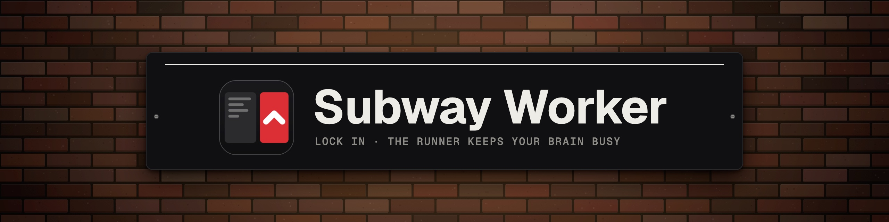
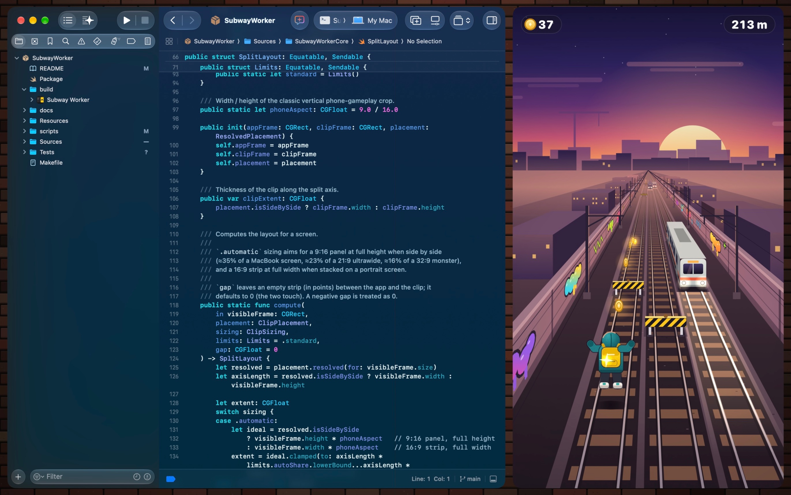
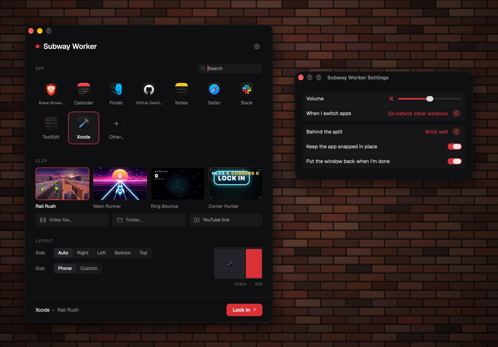
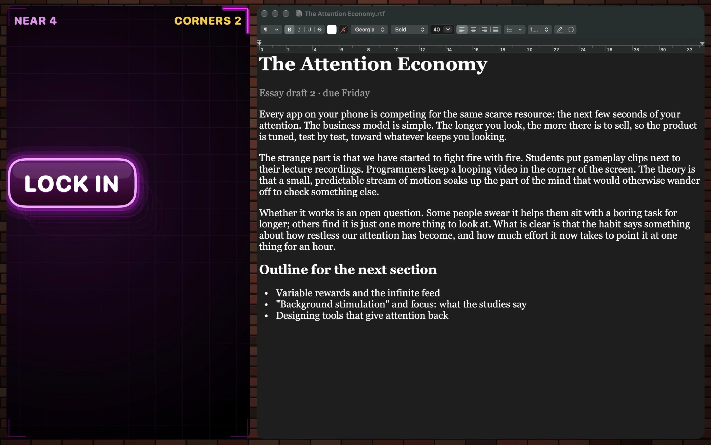

<p align="center">
  
</p>

<p align="center">
  
  
  
</p>

<p align="center"><b>Your work on one side. An endless runner on the other. Your brain, finally quiet.</b></p>



You know those videos with a podcast on top and gameplay underneath? Turns out your brain likes that
for work, too. Subway Worker snaps any Mac app to the big side of your screen and loops runner
gameplay on the other. Lock in. 🚇

## What it does

- 🪟 **Snaps any app.** The real window, not a copy. Keep working like normal.
- 📱 **Phone-shaped clip.** 9:16 down the side, or a strip along the bottom on portrait screens.
- 🎮 **Bring your own brainrot.** Four built-in loops (Rail Rush is the train-yard one), your videos, a shuffled folder, or a YouTube link.
- 🧱 **Brick wall backdrop.** So it looks like one screen, not two windows having a moment.
- ↩️ **Puts everything back** when you're done.



## Install it

```bash
git clone https://github.com/s4rv4d/subway-worker.git
cd subway-worker
make install
```

Needs **macOS 26** and **Xcode 26** or later. No Apple developer account required.

## Use it

1. Open **Subway Worker** from Applications.
2. First time only: click **Allow…** and switch it on under Accessibility. That's how it moves
   your windows around.
3. Pick an app, pick a clip, hit **Lock in**.

Hover the clip for its controls. End the session, or quit, and your window goes back where it was.



## Privacy

- **Local by default.** No accounts, analytics, telemetry or update checks. Nothing is sent anywhere.
- **The one exception: YouTube links.** If you paste one, it plays in YouTube's privacy-enhanced
  player, so YouTube sees that request. Nothing is kept between sessions.
- **Accessibility only moves the window you pick.** It reads that window's position, size and state,
  never its title or contents. It doesn't watch your keys, clicks or screen.
- **Your files stay yours.** It only opens the videos or folders you choose, and only reads the
  clipboard when you hit *Paste YouTube Link*.

## FAQ

**Will this help me focus?** Science: unclear. Vibes: yes.

**Is this Subway Surfers?** Nope. The built-in loops are original, drawn in code. Bring your own
clips for the real thing. Not affiliated with the game.

**App Store?** Can't. Apps there aren't allowed to move other apps' windows.

<sub>Set in Geist and Geist Mono by Vercel (SIL Open Font License).</sub>

---

<p align="center">
  <b>Built for fun</b> by <a href="https://x.com/serverConnectd">s4rv4d</a>. Productivity not guaranteed.
</p>
